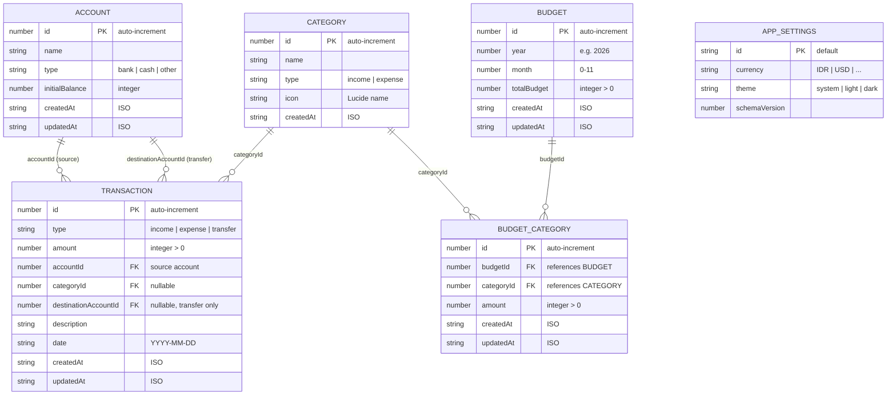
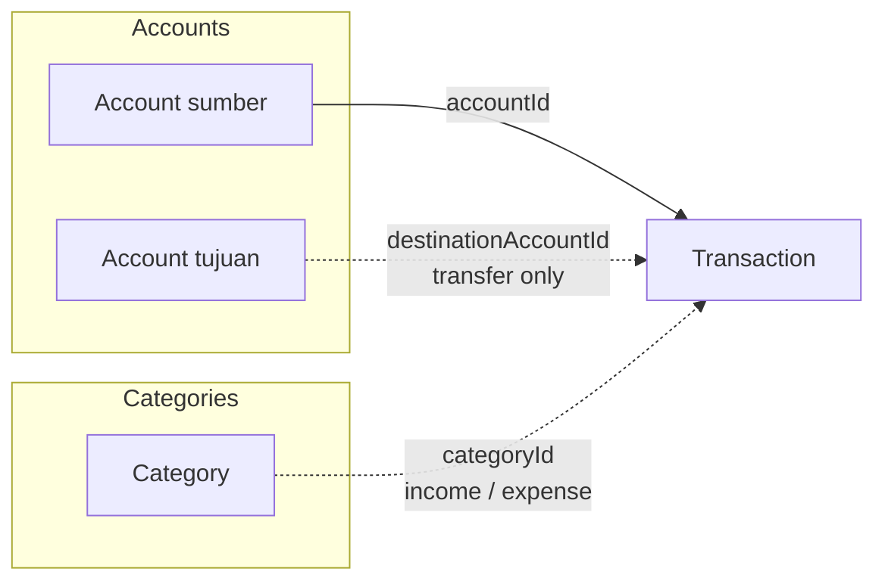

# Entity Relationship Diagram (ERD)

**Database:** IndexedDB via Dexie (`moneyTrackerDB`)  
**Schema version:** 1  
**Source of truth:** `src/db/database.ts`, `src/types.ts`

---

## Overview

MonTra menyimpan empat store lokal. Relasi utama berpusat pada **Transaction**, yang mereferensikan **Account** (sumber / tujuan) dan opsional **Category**. **AppSettings** berdiri sendiri (singleton `id = 'default'`).

---

## Diagram ERD



---

## Relasi

| From | To | Cardinality | FK field | Wajib? | Catatan |
|------|-----|-------------|----------|--------|---------|
| Transaction | Account | N : 1 | `accountId` | Ya | Akun sumber (income/expense/transfer out) |
| Transaction | Account | N : 1 | `destinationAccountId` | Hanya transfer | Harus ≠ `accountId` |
| Transaction | Category | N : 1 | `categoryId` | Tidak (transfer biasanya kosong) | Harus cocok tipe income/expense |

`AppSettings` **tidak** berelasi ke entitas lain.

---

## Aturan bisnis (integrity)

### Transaction.type

| type | categoryId | destinationAccountId | Efek saldo |
|------|------------|----------------------|------------|
| `income` | Direkomendasikan (kategori income) | — | `+amount` di `accountId` |
| `expense` | Direkomendasikan (kategori expense) | — | `−amount` di `accountId` |
| `transfer` | Biasanya kosong | Wajib | `−amount` di sumber, `+amount` di tujuan |

### Saldo akun (derived, tidak disimpan)

```
currentBalance =
  initialBalance
  + Σ income(accountId)
  − Σ expense(accountId)
  − Σ transferOut(accountId)
  + Σ transferIn(destinationAccountId)
```

### Constraints yang ditegakkan di aplikasi / backup validation

- `amount` harus number, `> 0`, integer
- `date` format `YYYY-MM-DD`
- Transfer wajib punya `destinationAccountId` dan berbeda dari `accountId`
- ID akun/kategori dalam backup sebaiknya unik; orphan FK menghasilkan warning saat restore

---

## Indexes (Dexie)

```
transactions:     ++id, date, type, accountId, categoryId, destinationAccountId, createdAt, updatedAt
accounts:         ++id, name, type, initialBalance, createdAt, updatedAt
categories:       ++id, name, type, icon, createdAt
settings:         id, currency, theme, schemaVersion
budgets:          ++id, &[year+month], year, month, createdAt, updatedAt
budgetCategories: ++id, budgetId, categoryId, &[budgetId+categoryId]
```

`++id` = primary key auto-increment. Field lain di-index untuk query (filter bulan, filter akun, dll.).

---

## Entitas di luar DB (bukan tabel)

| Konsep | Penyimpanan | Relasi ke ERD |
|--------|-------------|---------------|
| `AccountWithBalance` | Computed di memory | View atas Account + Transaction |
| `MonthlySummary` | Computed di memory | Agregasi Transaction (+ Category) |
| `BackupData` | File JSON export | Snapshot: settings + accounts + categories + transactions |
| Umami pageviews | Remote (opsional via env) | Bukan data keuangan |

---

## Diagram alur referensi transaksi



---

## Contoh instance

```
Account(#1, BCA, bank, 0)
Account(#2, Cash, cash, 0)
Category(#10, Food, expense, Utensils)

Transaction(
  type: expense,
  amount: 25000,
  accountId: 1,
  categoryId: 10,
  description: "Lunch",
  date: "2026-09-19"
)
→ BCA balance −25.000

Transaction(
  type: transfer,
  amount: 100000,
  accountId: 1,
  destinationAccountId: 2,
  description: "ATM withdraw",
  date: "2026-09-19"
)
→ BCA −100.000, Cash +100.000
```

---

## Referensi

- Schema: [`src/db/database.ts`](./src/db/database.ts)
- Types: [`src/types.ts`](./src/types.ts)
- Backup validation: [`src/services/backupService.ts`](./src/services/backupService.ts)
- Product scope: [`PRD.md`](./PRD.md)
